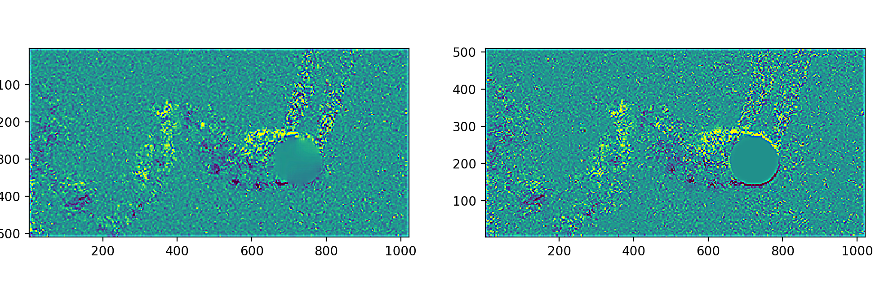

# OpenPIV + pivpy tutorial: von Kármán vortex street vs PIVlab

A hands-on tutorial for **modern OpenPIV (Python)** and **[pivpy](https://github.com/alexlib/pivpy)**,
built around a real dataset: a von Kármán vortex street behind a cylinder, with an equivalent
**PIVlab (MATLAB)** analysis to compare against. Rather than a black-box "run this pipeline"
script, each notebook teaches one part of doing PIV *well* — masking, parameter choice,
validation, vorticity, and cross-tool comparison — as a series of interactive
[marimo](https://marimo.io) notebooks.

Image data from [@Shrediquette](https://github.com/Shrediquette), shared via Google Drive.
Vorticity computed with [pivpy](https://github.com/alexlib/pivpy).



## Quickstart

Requires [uv](https://docs.astral.sh/uv/).

```bash
uv sync
uv run marimo edit notebooks/01_load_and_mask.py
```

Or run any notebook non-interactively as a script:

```bash
uv run notebooks/03_multipass_piv.py
```

## The tutorial

Work through in order — each builds on the previous one's output:

1. **`01_load_and_mask.py`** — load an image pair, mask the cylinder with
   `openpiv.preprocess.dynamic_masking`, and tune the masking parameters interactively (mask the
   body, not its shadow).
2. **`02_choosing_parameters.py`** — the window size / overlap trade-off, why multipass window
   deformation beats picking one window size, and how to estimate a signal-to-noise validation
   threshold from data instead of guessing.
3. **`03_multipass_piv.py`** — the full 4-pass windowed-deformation pipeline
   (`openpiv.windef.PIVSettings` + `windef.piv()`) across the whole image sequence, matched to
   PIVlab's settings for a fair comparison.
4. **`04_vorticity_with_pivpy.py`** — load the results into `pivpy`'s xarray-based `.piv`
   accessor and compute vorticity across the sequence.
5. **`05_compare_to_pivlab.py`** — load the equivalent PIVlab session output and compare: first
   on velocity (the trustworthy check), then on vorticity (noisier, and why).

Along the way we hit real friction in both `openpiv-python` and `pivpy` — including a genuine
bug — documented in **[FINDINGS.md](FINDINGS.md)** as candidate upstream issues.

## Layout

```
data/                      original image pairs (karman_16Hz_NNN_{A,B}.jpg)
PIVlab results/6pixels/    PIVlab's output for the same sequence (comparison baseline)
notebooks/                 the tutorial (marimo notebooks, run in order)
notebooks/results/         output of running notebooks/03 (generated, not committed)
FINDINGS.md                openpiv-python / pivpy issues found while building this
```
